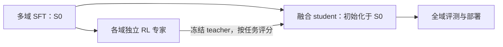

# 对话摘录

真实用户与助手可见消息；省略工具和系统内容，内部路径已脱敏。

**用户**

现在是周末。趁现在快做一些大规模运算。你最多可以用
卡组：merlin [authorized resource group]
ai_NVIDIA-H20 cloudnative-lf（高优先限额64卡，低优先不限）。
做不超过3000卡时。

**助手**

我按你这次授权切到 `[authorized resource group] / cloudnative-lf` 的 H20，累计控制在 **3000 卡时以内**。先核验队列和启动配置，立即跑真实 GPU 预验；通过后扩展并行生成、训练对照和评测，把算力用在模型质量结果上。

**助手**

目标队列已核验：`cloudnative-lf` 当前可见 **104 张 H20 余量**。我会先用 1 张卡完成加载、反向和恢复检查，再扩到 8–32 张卡并行执行；高优先任务合计不超过 64 张，每次提交前预留完整窗口卡时。

**助手**

单卡预验已提交，任务 ID：`56015f3fb1bc58ef`，14 项预检全部通过，目前在拉起。与此同时我会准备扩大实验：新增可自动判题的代码任务，保留原 MBPP 对照，并用多个训练种子和独立评测检查收益，避免只得到单次训练成绩。

**助手**

H20 已分配并进入用户脚本，正在准备模型缓存。扩展题库共 **8192 道新生成的代码任务，每题 56 个测试输入**，参考程序与另一套计算逻辑正在逐题核对。它用于验证新规格上的泛化；原 MBPP 结果会单独报告。

**助手**

真实 H20 预验已通过：保存并重建后的下一步 loss 完全一致，**adapter 最大误差为 0**；显存峰值约 **8.34 GiB**，增量 checkpoint 约 **98 MiB**。8192 道新题的参考程序也全部通过测试。现在开始扩到多卡并行生成。

**助手**

首批 **8 张 H20** 已提交，任务 `3ed65e910ba8dbd3` 将生成 MBPP 的 800 个候选。当前全局保守预留约 **26.08 卡时**，包含启动余量，远低于 3000 卡时上限；接下来验证这批分片运行，并继续展开新题库的 32 卡任务。

**助手**

我继续推进周末这批实验，先检查已提交的 8 卡生成任务是否正常运行，再扩到新数据集的并行生成；预算继续按不超过 3000 卡时控制。

**助手**

首个 8 卡任务在启动阶段退出了，日志确认 ByteNAS 不支持缓存锁所用的 `flock`（Errno 38），尚未开始生成。我会改用原子目录锁，复测后重新提交；失败任务的预算仍保留计入。

**助手**

锁的修复已通过原有 11 项 CPU 回归，包括预算互斥和 checkpoint 恢复。新题库已冻结为 6144 道训练题、768 道开发题、1280 道盲测题；我正在准备 32 个生成分片，待首节点产出正常候选后扩算。

**助手**

修复后的 8 卡任务已重新提交，14 项平台预检全部通过。另已验证分片不重叠、采样种子保持一致、恢复时不重复生成，并加入结果合并检查，防止用不完整候选池做训练对照。

**助手**

8 卡节点已进入运行态，正在校验缓存、准备本地权重，暂未占用 GPU 显存。我已启动在线检查；后续训练将按 18 个配置的开发集结果选择一个公共学习率，再固定 A/B 各三个种子做盲测。

**助手**

8 张 H20 都已开始生成候选，每卡显存约 8.5 GiB，当前已看到 59 条完整候选，无截断。我现在提交新题库的 4 个八卡节点，将生成并发扩到 40 卡；每个节点仍保留两小时上限。

**助手**

新题库的 32 卡任务已全部提交，当前生成任务合计 40 卡。我也提交了原模型的开发集评测，并抽取 32 条候选做 CPU 判题，先检查格式、测试通过情况和耗时，再进入训练。

**助手**

启动样本的 CPU 判题已完成：32 条候选中 26 条通过，0 条截断，中位生成耗时 1.92 秒。这仅说明生成流程正常，不能算训练收益。7 个任务的并发上限合计 49 卡，累计保守预留 173.48 卡时；我会继续收齐候选池并跑训练对照。

**助手**

我先检查已启动任务的产出和退出状态，继续完成候选筛选、训练和盲测；总预算仍按不超过 3000 卡时控制。

**助手**

MBPP 的 800 个候选和两个数据集的 base 开发集都已完成并回收。新题库的 32 卡生成任务也都进入了计算阶段；我现在检查数据完整性并判题，随后启动 A/B 训练。

**助手**

完整判题结果：MBPP 候选通过 517/800，153 道题有可用答案，A/B 各选 105 道；base 开发集为 MBPP 28/50、新题库 666/768。新题库基线较高，后续会重点看独立评测增益和多种子稳定性。

**助手**

已接上自动执行流程：完整候选池 → 等 token 预算训练 → 开发集选择 → 冻结后盲测。新题库使用 18 个训练配置，每次提交都检查并发和卡时账本；结果缺失或训练未完成时会停在门槛处，避免用不完整结果选模型。

**助手**

MBPP 的双卡训练已提交，当前任务合计占用上限为 34 卡，保守预留 179.5 卡时。新题库 32 个分片都持续产出候选；我还抽取了启动样本检查截断和可用答案比例，完整训练选题仍等全部 24,576 个候选判完。

**助手**

新题库启动样本共 128 题、512 个候选：402 个通过，127 题至少有一个可用答案，未发现截断。MBPP 训练节点已准备完成，接下来核对实际训练进度、监督 token 数和 checkpoint。

**助手**

两组 MBPP 都已完成至少 5 个真实 optimizer step，loss 有限，显存约 12–13 GiB。当前只有训练进度证据；最终增益还需等训练完成后的开发集和盲测结果。

**助手**

我继续跟进已启动的训练和评测，先确认 MBPP 训练结果与 32 卡数据生成进度，再推进验证集和盲测。仍按你授权的卡组、最多 64 张高优先卡和 3000 卡时上限执行。

**助手**

MBPP 两组训练已完成，实际都用了 14,756 个监督 token，完整 checkpoint 和文件校验通过。两组 adapter 正在评测 50 道开发题；新规格题库的 32 卡生成仍在运行，需完整回收后才能判题和启动 18 组训练。

**助手**

MBPP 开发集已回收：B 为 29/50，base 为 28/50；我正在核对 A 组结果和冻结决策。这一题的差距还不能说明稳定提升。另有一个本地观察器退出，我已补启只读收集器，并继续跟进后续评测。

**助手**

MBPP 开发集 A 为 31/50，B 为 29/50，base 为 28/50。按既定规则冻结 A 组，已启动 170 道盲测；A 相对 base 的开发集配对置信区间仍跨过 0。新规格题库现场已写入 12,734/24,576 个候选，32 个分片都在持续产出。

**助手**

当前累计保守预留 191.53 卡时，活跃任务共 34 张 H20，均在指定队列内。我也在补齐成本记录：分别统计脚本执行时间和 Pod 启停时间，最终报告会列出测量范围，避免把预留额度当作实际费用。

**助手**

成本记录已覆盖 7 个结束任务：Pod 启停区间合计 4.48 卡时，其中脚本执行约 3.69 卡时。32 卡生成和 2 卡盲测仍在运行，尚未计入这两个完成量。后续 18 配置的训练和评测会继续按预算自动推进。

**助手**

盲测和 32 卡生成仍在运行，目前没有触发数据缺失、训练失败或预算停止条件。我正在检查各分片的新增候选和写入时间，确认生成在持续推进；盲测完成后会立即核对完整结果。

**助手**

新规格题库已写入 16,061/24,576 个候选，进度约 65%；各分片的最近写入都在 9 秒内。MBPP 盲测现场已生成 base 134/170、A 125/170，尚未完成判题。

**助手**

两条流水线目前都没有报错，盲测还在生成剩余题目。我会等完整输出回收并通过校验后，再比较 base 与 A 的通过率和配对置信区间。

**助手**

MBPP 盲测两侧都已生成完整的 170/170 条输出。接下来核对归档和文件哈希，再执行 CPU 判题；很快就能确认开发集的提升是否延续到盲测。

**助手**

盲测两侧都已确认 `complete=true`，子进程返回码均为 0，脚本执行约 638 秒。目前正在等待归档导出和回收完成；计分完成后，这份结果就能用于判断 A 组是否有盲测收益。

**助手**

MBPP 盲测结果已核对：base 95/170，A 105/170，通过率从 55.88% 提升到 61.76%，增加 5.88 个百分点；配对 95% CI 为 [+2.34, +9.94] pp。这次单种子对照有正向结果，但还需新规格题库的多种子实验验证稳定性。32 卡大规模生成仍在继续。

**助手**

继续推进周末实验。MBPP 盲测已完成：95/170 → 105/170；接下来核查新题库候选生成，继续完成多种子训练和盲测，并控制在授权卡数与卡时内。

**助手**

新题库的 4 个八卡任务仍在运行，32 卡候选生成尚未结束。后续按已冻结的流程检查完整候选池，再做 18 个等监督 token 训练配置；只有全部开发集结果齐备后才选择公共学习率、进入盲测。当前累计保守预留约 191.53 卡时。

**助手**

现场已提交 19,834/24,576 条候选，约 80.7%；32 个分片都在持续写入，尚未发现停滞。MBPP 盲测的净增益来自 11 道由错转对、1 道由对转错；它仍是单种子结果，稳定性还需看新题库的三种子对照。

**助手**

候选池已达到 20,480/24,576（83.3%）。现场计数现已排除每个分片的协议文件。训练产物导出只保留最新 checkpoint，每节点限制在 1 GiB 内；完整性、哈希和等 token 检查通过后才会评测。

**助手**

按现有矩阵，后续训练用 18 卡、开发集评测用 36 卡、盲测用 28 卡。即使进入全部盲测，加上启动和终止余量，累计保守预留预计约 438 卡时；各阶段都低于 64 卡并发上限。当前仍在等待完整候选池。

**助手**

候选数已增至 21,250（86.5%）。新题库 base 开发集为 86.72%，后训练的提升空间较小；两组平均开发集增益若都不为正，就会按冻结规则停止盲测。这也会控制后续算力投入。

**助手**

当前候选池为 21,684/24,576（88.2%），最快分片还差 33 条，最慢分片还差 173 条。已有基线显示，成对变换和前缀累积题的错误较多；我会在结果报告中列出分类诊断，训练和盲测仍按已冻结的方案执行。

**助手**

我继续跟进新题库的32卡计算，先核对候选池和任务终态，再推进18组训练与评测。MBPP盲测已完成：净增10题，提升5.88个百分点。

**助手**

候选池已写入23,443/24,576条（95.4%），部分分片已经完成，最慢分片为653/768条。流水线仍在运行，尚无错误；完整回收并校验后才会开始筛选训练数据。

**助手**

目前保守预留191.53卡时，远低于3000卡时上限。接下来会固定候选池，比较随机选题与难题优先选题，并用三个种子和公共学习率评测；开发集两组均无增益时，按原规则停止扩算。

**助手**

已有一个8卡节点完成全部6,144条候选，八个进程均正常退出；总进度为23,888/24,576条（97.2%）。我已准备好只读诊断脚本，后续会记录两组题目重叠度、难度和错误分布，辅助解释质量差异。

**助手**

首个完成节点已成功归档到HDFS，入口日志显示正常退出，正在本地回收并校验文件。其余三个节点继续生成；随后会对完整24,576条候选执行CPU判题。

**助手**

总进度已到24,328/24,576条（99.0%），剩余248条。已完成节点的8卡已回收，当前仍有24卡运行；流水线尚未提交训练任务。

**助手**

新题库基线开发集的102条失败中，90条是答案错误，12条是运行错误，没有截断。后续会用相同题目和测试检查训练是否减少这些错误，并完整比较两组的三个种子。

**助手**

现在只剩107条候选，总进度99.6%。首个节点的归档校验已完成；其余分片继续写入，完整池到齐后将自动进入CPU判题。

**助手**

第二个8卡节点也已完成计算并成功归档，正在回收校验。剩余两个节点仍在生成最后一批候选。

**助手**

候选池只剩19条，已完成99.9%。两个节点的归档已通过本地校验；下一阶段会报告通过测试的候选数量、可训练题量，以及A/B最终一致的监督token预算。

**助手**

第三个节点也已完成并提交归档，剩余最后一个节点。当前保守预留仍为191.53卡时；已结束任务的Pod驻留区间合计27.19卡时，运行中的任务尚未计入该实测数。

**助手**

32卡候选生成已全部正常结束，四个节点都成功提交了归档。最后一个归档正在本地回收；完成校验后，流水线将判题并冻结A/B训练集。

**助手**

四个归档都已通过本地校验，正在合并完整候选池并检查缺失、重复和采样协议。生成阶段的32卡已全部回收；截至此时，已结束任务的Pod驻留区间合计51.18卡时。

**助手**

完整池检查通过：24,576条，无缺失、无重复，共生成506万输出token。20条候选截断，占0.081%，低于预先设定的5%停止阈值；CPU判题已开始。

**助手**

CPU判题已完成12,889条，约一半。完整池的校验结果和资源驻留记录已写入实验文档；训练集会在全部判题完成后一次冻结。

**助手**

判题进度已到18,691/24,576条（76.1%）。全部完成后，流水线会固定可用题量，并提交A/B × 三个种子 × 三个学习率，共18个LoRA配置。

**助手**

完整判题已完成：18,939/24,576条候选通过测试，6,051道题至少有一个通过答案。A/B训练集已冻结，每组4,235题；流水线正在准备18组训练任务。

**助手**

首批8组训练已提交，14项预检全部通过。选题诊断显示，A所选题的原模型候选通过率为78.30%，B为68.92%，难度差已形成；最终是否有质量收益仍要看完整评测。

**助手**

18组训练已全部提交，分为8+8+2张H20，三批任务的14项预检均通过。累计保守预留245.68卡时；我继续核对实际启动和训练进度。

**助手**

三批任务都已实际进入Running，18张H20正在执行。发现本地自动启动的观察器退出，我已补启只读观察器并恢复状态采集；远端训练任务没有重提。

**助手**

现场已看到真实optimizer更新：首批8组各完成13–14步，第二批各6步，第三批仍在准备。当前loss均为有限值；训练完成前暂不进行质量判断或提交adapter评测。

**助手**

训练继续运行，项目状态文件已更新为“完整候选池已校验判题、18组训练运行中”。MBPP的最终分数与新题库仍待评测的状态分别记录，后续会以完整checkpoint和评测结果更新结论。

**助手**

18组都已开始更新：首批28–29步，第二批22–23步，第三批14步。两次采样间，首批每配置约188监督token/秒；训练仍在推进，当前尚无新题库质量分数。

**助手**

我继续跟进这批 18 路训练，核验完成后的 checkpoint 和等 token 预算，再推进开发集选参与盲测。当前已完成的 MBPP 对照提升为 5.88 个百分点；题库实验还没有最终质量结论。

**助手**

18 路训练都在推进，目前每路已完成约 4.5万–6.6万监督 token，loss 均为有限值。按当前速度，训练仍需约一个半小时；完整题库候选已回收并判题，后续评测继续按冻结规则执行。

**助手**

首批 8 卡现场显存占用约 17–20 GiB，瞬时 GPU 利用率为 10–48%。这轮运行的是固定的 PyTorch 路径，速度偏慢；我会保留这组运行数据，用于结果后的性能分析。

**助手**

三个训练任务仍在运行，观察器持续正常采集。累计保守预留为 245.68 卡时；后续开发集与盲测阶段按现有矩阵执行，预算仍在 3000 卡时上限内。

**助手**

提交记录已核对：这 15 个任务均使用指定 H20 资源组、关闭自动重启，最终 payload 与提交请求一致，预检 SID 均已保留。训练仍在推进，每路目前约完成 6.4万–9.1万监督 token。

**助手**

18 路训练已完成约 9.3万–11.8万监督 token，近期速度中位数约为每卡 179–200 token/s。当前没有训练完成状态；接下来核对周期 checkpoint 是否已写入。

**助手**

已有 16 路周期 checkpoint 写入完成，指针和 manifest 哈希核对通过，记录的监督 token 预算均为 100 万。接下来调整本地观察器启动方式，让后续评测批次能自动接续；训练完成后仍会校验最终 checkpoint 的全部文件。

**助手**

观察器调整已通过 8 项 CPU 回归，并在一个真实已结束任务上完成查询和归档核对。本地流水线已切换到新方式，接下来验证运行中任务的持续采集和观察器去重。

**助手**

新观察器已开始采集运行中的训练任务，重新读取候选池后哈希也保持一致。18 路训练目前完成约 16.8万–19.3万监督 token，继续等待训练完成。

**助手**

三路训练观察器均已切换并持续采集，未出现新观察错误。当前仍有 18 张卡训练，候选池和冻结选择的哈希保持一致；最终训练校验、开发集选参和条件盲测都还在后续流程中。

**助手**

18 路训练目前各完成约 21%–24% 的监督 token 预算，观察器持续正常，尚无流水线错误。接下来等待训练完成，再核验全部 checkpoint 并进入开发集评测。

**助手**

我继续跟进这批 18 个训练配置，核验完整 checkpoint 和等 token 预算，再按冻结规则跑开发集与盲测。当前并发 18 张 H20，累计预留约 246 卡时。

**助手**

18 路训练已完成各自约 23万–26万监督 token，目标均为 100万；最近速率约 170–182 token/s，按此估算还需约 70 分钟。两组仍按完整的三个种子、三个学习率运行，公共学习率将由全部 18 项开发集结果确定。

**助手**

已核对全部 18 个周期 checkpoint 的指针、manifest 哈希和训练配方。每个 8 卡节点最新 checkpoint 合计约 819 MB，低于 1 GiB 导出上限；各节点还剩约 91–93 分钟执行窗口，当前估算能在窗口内完成。

**助手**

三路任务和本地收集器都正常，状态记录持续刷新。最终评测仍要等训练达到完整 token 预算并通过 checkpoint 全文件校验后才会启动。

**助手**

训练进度已到约 28%–31%，三批最近速率约 175、214、196 token/s。当前没有完成状态，也没有训练收益分数；我继续核对进度和超时余量。

**助手**

已更新状态文件，记录 18 个周期 checkpoint 的核验结果。接下来会比较前后 checkpoint 的 adapter 文件哈希，确认训练持续写出不同的权重内容。

**助手**

全部 18 个配置的前后周期 checkpoint 都有不同的 adapter 文件哈希，训练配方保持一致。这确认了权重文件内容持续变化；质量提升仍需完整评测判断。

**助手**

最新进度为每配置约 32.6万–36.1万 token，最近速率约 174–186 token/s。18 路仍在训练，预计约一小时后完成，再进入开发集评测。

**助手**

18 路训练的状态持续刷新，收集器未记录错误。当前并发仍是 18 张 H20，预算预留约 246 卡时。

**助手**

三批任务仍正常运行。后续开发集将评测全部 18 个配置，计划使用 36 张 H20，继续受 64 卡并发上限控制。

**助手**

每个配置已完成约 35.9万–39.6万监督 token。第三批近期约 165 token/s，稍慢于前两批，但按当前速率仍能在窗口内完成；我会继续检查余量。

**助手**

收集器仍持续更新三批任务状态，没有新的错误记录。等 18 路训练全部完成后，流水线会核验归档并接续开发集评测。

**助手**

运行状态保持稳定，并发仍是 18 张 H20。训练完成后的开发集阶段会新增约 108 卡时保守预留，届时累计约 354 卡时。

**助手**

最新进度为 39.2万–43.1万 token。最慢一批近期约 162 token/s，按当前速率估算还需约 63 分钟；现有窗口仍有余量。

**助手**

三批任务仍在运行，尚未进入最终导出。我继续检查训练进度和收集器状态。

**助手**

本轮状态检查正常：三路收集器都在刷新，未记录新错误。最终 checkpoint 尚未产生。

**助手**

训练进度已到约 42.1万–47.2万 token。最慢一批近期约 159 token/s，按此估算还需约一小时；训练 loss 的变化不会用于修改冻结配方。

**助手**

三批训练仍正常运行。我补采一轮 GPU 型号、显存和利用率，留作运行证据；利用率只代表采样时刻。

**助手**

已实测确认全部 18 张卡均为 H20；这轮显存占用约 20–30 GiB，瞬时利用率为 5%–48%。采样已保存，训练仍正常推进。

**助手**

最快的配置已超过 50万 token，全部配置处于约 45.8%–51.2%。18 路仍在训练，尚无最终 checkpoint。

**助手**

训练任务和收集器都保持正常。周期 checkpoint、权重文件变化及 18 卡硬件采样的证据已保存，后续继续等待完整训练与评测结果。

**助手**

补充核对了冻结选题的分布：A/B 平均组合长度约 3.99/4.02，B 的答案字符数平均多约 3.6%，首操作分布的总变差为 5.27%。这些差异已记录，最终结果不能仅归因于难题优先策略。

**助手**

前两批全部超过 50万 token，第三批为 49.2万–50.0万 token，近期速率回升到约 178 token/s。训练继续按 100万 token 目标推进。

**助手**

三批任务仍正常运行，状态和日志持续刷新。训练尚未结束，我会继续跟进最终 checkpoint 的产生与回收。

**助手**

全部 18 个配置都已过半，当前为 51.3万–58.2万 token。最慢一批近期约 149 token/s，按此估算还需约 54 分钟；现有窗口仍有余量，接下来重点核验完成状态和最终归档。

**助手**

我继续跟进这18组训练，核对完整权重和等 token 预算；完成后接续全部开发集评测，再按冻结规则决定盲测。仍按64卡并发、3000卡时上限执行。

**助手**

18组已完成各自训练预算的59%–68%，日志继续推进。按最近速率估计，最慢一组还需约40分钟；完整候选池、选题和训练配方都保持冻结。

**助手**

三路任务和本地收集器都正常，尚无完成权重可进入评测。我也会把实际Pod驻留卡时整理进最终报告，保留预算预留与平台账单的区别。

**助手**

下一阶段共18个开发集配置，计划用36张H20分片评测。公共学习率会按两组、三个种子的六项均分选择，保持原定规则。

**助手**

最新进度为63%–72%，三批近期速率约161–187监督token/s。当前仍是训练执行证据，质量结论要等完整评测。

**助手**

18张训练卡仍在运行，收集记录持续刷新，尚无任务失败或收集错误。

**助手**

最终会同时报告A/B各三个种子的成绩、均值和标准差，并给出同种子的B相对A配对差异。

**助手**

训练仍按同一100万监督token预算推进，三路采集均正常。我继续等完整终态和归档校验。

**助手**

18组已推进到66%–76%；最新进度已写入状态文件。尚无新题库质量分数。

**助手**

等18组全部通过最终权重、文件哈希和配方检查后，流水线会接续开发集评测。

**助手**

三批仍是running，观察记录均在半分钟内刷新；没有出现停滞或失败信号。

**助手**

最新进度为69%–80%，最慢一组约还剩31万token；近期训练速率保持稳定。

**助手**

当前仍为18卡并发，预算预留245.68卡时；后续开发集与条件盲测也在已授权额度内。

**助手**

三批仍在持续运行，完整训练归档尚未发布；我继续监控终态。

**助手**

进度已到72%–83%，最慢一组约剩28万token。三路收集器仍正常。

**助手**

最快的配置已超过80%预算；全部18组完成后才会进入开发集，保证比较口径一致。

**助手**

当前没有新增任务，仍在完成原来的18组训练。我会继续跟进到完整评测结果和资源核算。

**助手**

最新进度为75%–87%；最慢一组约剩25万token，仍有足够的有限任务窗口。

**助手**

三路任务保持正常，训练仍在推进；最终权重和开发集决策尚未生成。

**助手**

仍是18张训练卡在运行，收集器没有报错；下一次核对会检查是否有配置完成。

**助手**

进度已到78%–91%，尚无配置完成。最快几组接近收尾，最慢一组约剩22万token。

**助手**

三批任务仍正常，完整训练归档尚未回收；继续等待收尾。

**助手**

收集记录继续刷新，没有出现超时或错误。下一步仍是核对完整checkpoint。

**助手**

18组已完成81%–94%预算，最新状态已落盘。最快一组约剩6万token，尚未完成。

**助手**

三批仍在运行，收集器保持正常；还没有完整训练归档可用于评测。

**助手**

18组继续收尾，没有新增重试或任务；我继续监控完成状态。

**助手**

进度为84%–97%，最快一组约剩3万token。最慢两组近期速率有所波动，我会留意剩余任务窗口。

**助手**

三路任务和采集仍正常；尚未取得整批完成状态，继续等待。

**助手**

训练进入收尾阶段。我现在核对是否已有配置达到100万token，以及剩余配置的进度。

**助手**

已有2组训练状态显示完成，均达到100万监督token；其余16组继续推进。最慢一组约剩13万token，近期速率已恢复。

**助手**

已完成配置仍需整批归档与文件校验；其余训练继续运行，采集没有报错。

**助手**

三批仍在收尾。我继续核对剩余配置和归档状态，暂未启动开发集评测。

**助手**

已有7组状态显示完成，均达到100万监督token；其余11组进度为90%–近100%。整批归档校验还在等待。

**助手**

剩余训练继续推进，收集器均正常。我重点留意整批结束后的归档发布和回收。

**助手**

训练和采集继续正常，尚无整批结束信号。开发集仍等待全部18组通过完成检查。

**助手**

第二批8组全部达到100万token，另有1组显示完成；总计9/18组完成训练状态检查。第二批开始等待归档回收，其余继续收尾。

**助手**

第二批8组已成功终止并回收，完整checkpoint、所有文件哈希和配方核对通过，均为100万监督token。当前剩10张训练卡；已结束任务的Pod驻留合计63.89卡时，尚非平台账单。

**助手**

已回收的8组验证通过；剩余两批继续收尾。全部18组检查通过后，流水线会启动开发集。

**助手**

16/18组训练状态已完成，均达到100万token；最后两组约剩4.2万和0.6万token。首批8组也进入归档收尾。

**助手**

首批8组也已成功终止并回收归档。现在只剩最后2张训练卡，全部配置仍按原预算完成。

**助手**

最后一批仍在收尾，采集正常。它完成并通过归档校验后，会接续36卡开发集评测。

**助手**

17/18组训练状态已完成，最后一组还剩约1.3万token。前两批归档已回收，马上进入全部权重核对。

**助手**

最后一批还在发布完成状态，采集没有错误。我继续等待归档回收，不提前进入评测。

**助手**

三批训练都已成功终止并回收归档。流水线正在核对全部18个checkpoint；通过后按原矩阵启动开发集评测。

**助手**

全部18组已通过完整checkpoint、文件哈希、配方和等token检查，每组恰好100万监督token。训练阶段已结束任务的Pod驻留累计80.58卡时；现在进入18配置开发集评测。

**助手**

开发集首批8卡已提交，14项预检全部success，并保留precheck SID后即时提交。其余批次正接续准备，仍使用指定H20队列和有限任务窗口。

**助手**

开发集已提交4批、共32卡，前两批已进入running；各批14项预检均success。最后4卡正接续提交，完整评测覆盖全部18个配置。

**助手**

36卡开发集矩阵已全部提交，三批已进入running。20个任务的提交记录核对通过，预检SID、指定队列及自动重启0均符合配置；累计保守预留353.98卡时。

**助手**

36张H20已全部进入running，五路收集器没有报错。我继续跟进768题 × 18配置的完整开发集评测，再按冻结规则决定盲测。

**助手**

前16个CUDA进程已开始提交开发集答案，其余节点仍在准备。训练完成证据、36卡评测状态和资源账本已更新；现在还没有完整开发集分数。

**助手**

18 组训练已完成，每组都达到 100 万监督 token；36 张 H20 正在评估开发集。接下来等完整结果冻结共同学习率，再按既定规则完成盲测和资源核算。

**助手**

5 个开发集任务都在持续更新状态，本地收集器也正常。共同学习率将按 A/B、3 个种子的六项完整成绩均值选择；目前累计保守预留 353.98 卡时。

**助手**

36 个评测分片都已开始写入答案，首批每片约完成 45–50/384 题。此前训练的最终 checkpoint、文件哈希和配方已核对通过；剩下要确认完整质量成绩。

**助手**

一次本地状态查询超过了 45 秒，收集器已自动恢复并重新取得 running 状态，GPU 任务未重提。错误记录会保留，后续继续核对答案计数和状态更新时间。

**助手**

恢复后的状态查询在继续更新，5 批任务仍在运行。等全部 18 份开发集报告通过完整性核对后，就能冻结选择；盲测需要的 28 张卡也在并发和卡时上限内。

**助手**

开发集评测仍在运行，流水线没有新增错误。我正在核对 13,824 条应有输出的累计写入量，确认所有分片都持续推进。

**助手**

已写入 2,613/13,824 条开发集答案，36 个分片全部有输出，状态记录已更新。目前还没有完整开发集分数，不能判断 A/B 的增益。

**助手**

5 批任务仍在运行，查询状态都在最近 30 秒内更新。后续报告会保留各个种子的成绩、跨种子标准差和 B 相对 A 的配对差异。

**助手**

评测还未结束，当前仍是 36 张卡。我再取一次只读写入计数，确认进度；每批两小时的执行上限继续生效。

**助手**

已写入 3,692/13,824 条答案，全部分片都比上次增加。当前累计量约 26.7%，还没有完成全部开发集评测。

**助手**

36 张卡继续执行，状态查询在最近半分钟内更新，流水线没有报告失败。

**助手**

开发集还在运行。下一步仍由完整成绩决定是否进入盲测，两个组都没有平均增益时会按规则停止。

**助手**

5 个任务都保持 running，收集器状态正常。继续等待完整结果。

**助手**

当前仍在评测，未触发失败或停止。我再核对一次累计答案数。

**助手**

已写入 5,121/13,824 条答案，约 37.0%。按最近写入速度估算，还需要约二十多分钟完成开发集；后面还要回收归档并在 CPU 判题。

**助手**

评测继续，36 张卡和本地流水线都正常，暂无新的错误记录。

**助手**

所有任务仍在 running。累计预算没有变化，保持 353.98 卡时保守预留。

**助手**

开发集仍未结束，最近一轮状态更新正常。继续等全部分片，确保 18 项配置都按同一评测口径进入选择。

**助手**

任务状态仍正常，我再取一次答案计数，检查各分片的推进量。

**助手**

已写入 6,570/13,824 条答案，约 47.5%；各分片都在推进。当前最慢的分片完成 156/384 题。

**用户**

不好意思打断一下你。我想做一个OPD相关的工作。
预训练的基础上，做一下OPD。这个可以重点讲一下。
OPD放在SFT以后，还是RL之前？还是在RL时引入？从base模型到部署模型的完整流程，多域混合SFT后再分阶段RL是否可行？
初始化与Teacher：student 哪个checkpoint开始初始化，做OPD 之前怎么判断student能从teacher学到东西，teacher与student的规模差距、词表约束，异源teacher是否可行？
业界路线：按任务路由teacher、RL与OPD联合训练是否属于常规做法，与MiMo、GLM、DeepSeek的公开做法有什么区别，多任务融合还有哪些路线。
实现与效果：topk与采样token的取舍；异步连中陈旧数据的处理、融合后与各领域专家差多少，有没有单域回退。
（基座组面试官通常是一线研究者，会直接拿自家方案比较）

**助手**

我先把 OPD 的训练阶段、Teacher 选择和实现取舍整理成能经得住研究者追问的材料，并核对 MiMo、GLM、DeepSeek 的公开依据。同时检查刚才实验的进程状态，确认中断是否影响后台流水线。

**助手**

先明确定位：OPD（On-Policy Distillation）按 student 自己生成的轨迹向 teacher 学习，可以作为 SFT 后的独立阶段，也可以与 RL 联合训练。下面我会区分公开方案和工程建议。刚才的 H20 流水线仍存活，实验继续运行。

**助手**

公开资料显示三条路线需要分开讲：MiMo 用领域专家做 MOPD 融合；GLM-5 在分阶段 RL 中用跨阶段 OPD 防遗忘；DeepSeek-V4 也明确采用多专家 OPD。这些版本的训练顺序和蒸馏目标不同，不能概括成同一套流程。

**助手**

有两点对面试回答很关键：MiMo 的表格里仍有领域落后于专家；而 MOPD 消融中，更大的 teacher 也可能因分布差距过大导致退化。Teacher 选择需要看 student 状态上的可学习性，不能只看参数量和榜单分数。

**助手**

实现上也要分清目标：MiMo 的 sampled-token PG、论文里的修正 top-k loss、DeepSeek-V4 的 full-vocabulary reverse KL，并不是同一种估计。材料会重点写清 top-k 截断偏差，以及异步 importance sampling 能校正什么、仍留下什么偏差。

**助手**

材料已写入工作区，包含训练流程、Teacher 资格评估、关键公式、异步数据契约和实验矩阵。建议把项目重点放在“同源专家融合与有界异步”：分别量化单域迁移缺口、融合干扰，以及质量约束下的有效吞吐收益。

**助手**

建议把这项工作定义为：**同源领域专家的能力融合，以及质量约束下的异步 OPD**。基座组面试时，重点讲初始化依据、可学习性、梯度目标、领域干扰和真实成本。

完整材料已保存到[OPD 设计与面试材料](computer://[local path redacted])，包含公开来源、公式、代码入口和实验矩阵。以下是核心判断。

**1．OPD 放在哪里，取决于要解决什么问题。**

OPD 的定义是：student 生成自己的轨迹，teacher 在这些轨迹的前缀上提供监督。它可以使用直接分布 loss，也可以复用 RL 的 policy-gradient 更新。

| 目标 | 推荐顺序 |
|---|---|
| 吸收已有强 teacher 的能力 | SFT → OPD → 可选 RL |
| 融合多个领域专家 | 多域 SFT → 各域独立 RL → MOPD |
| 顺序强化并恢复遗忘能力 | SFT → 分阶段 RL → 跨阶段 OPD |
| 同时模仿专家与优化任务结果 | SFT → OPD + RL |

因此，**多域混合 SFT 后再分阶段 RL 可行**，但要保存阶段 checkpoint，并持续评测全部领域。OPD 可以在最后恢复能力，也可以与任务奖励联合训练。

完整部署链路还应覆盖：预训练 → 可选领域/长上下文 mid-training → SFT → 强化与融合 → 全域验收 → 量化、推理框架与服务验收。OPD 后若继续通用对齐，也要重新检查领域回退。

**2．Student 初始化和 Teacher 选择，是第一组关键实验。**

对于上图的融合路线，我建议 student 和各领域专家都从共同的 `S0` 初始化。这也是 [MOPD 方法论文](https://arxiv.org/html/2606.30406)的默认方案。从某个最强专家初始化可能更快，但会引入领域偏置，应单独消融。

Teacher **不必更大**。同规模模型经过领域 RL 后，也能向 student 提供新增能力。参数规模差距没有普适最佳比例，需要测：

- 同题、同工具、同输出预算下，teacher 是否显著强于 student。
- 在 **student 的错误前缀**上，teacher 是否还能提供有效继续动作。
- student 轨迹上的 KL、entropy、top-k overlap，是否主要反映能力差，还是格式和风格差。
- 短 OPD pilot 是否提高独立开发集成绩，并保持其他领域能力。

仅有 KL 降低不能证明学到了任务能力。

一个值得记住的公开反例：MOPD 消融把同源数学专家换成更大的 Qwen3-235B-A22B，初始 token KL 约从 0.04 升到 0.19，数学成绩反而退化。**这是特定配置的证据，不是异源 teacher 必然失败，也不是通用 KL 阈值。**

词表约束也要讲精确：直接 token KL 要求共同事件空间，必须核对 token ID 映射、分词、特殊 token 和模板；相同 vocab size 不够。异架构可以使用独立评分服务，异 tokenizer 则需要专门对齐。把字符串重新分词后逐位置减 logprob，不是合法的 token KL。第一轮建议同源、同 tokenizer。

**3．业界路线已经有先例，但各家的具体做法不同。**

| 公开版本 | 核心路线 |
|---|---|
| MiMo-V2-Flash | 领域专家 → MOPD；token advantage 可以叠加 outcome advantage |
| GLM-5 | 顺序 reasoning、agentic、general RL → 最终跨阶段 OPD，历史 checkpoint 作 teacher |
| DeepSeek-V3.2 | specialist 生成蒸馏数据 → mixed RL |
| DeepSeek-V4 | specialist SFT/RL → 多专家 OPD，以 full-vocabulary reverse KL 替代原 mixed RL 阶段 |

这里有两个容易被追问的细节：

GLM-5 的方法 §3.5 明确把跨阶段 OPD 放在**最后阶段**；不能笼统描述成每个 RL 阶段都持续加入 OPD。DeepSeek-V3.2 的专家数据蒸馏，也不能直接称为 student rollout 上的 token OPD。

所以，**teacher 路由和 RL＋OPD 都是有公开生产先例的可选路线**，但不能仅凭组合这些组件就主张算法创新。其他路线还有混合 RL、顺序 RL、专家轨迹 SFT、参数 merge、独立 adapter 和在线专家路由。

依据：[MiMo](https://arxiv.org/html/2601.02780v1)、[GLM-5](https://arxiv.org/html/2602.15763v1)、[DeepSeek-V3.2](https://arxiv.org/html/2512.02556v1)、[DeepSeek-V4](https://arxiv.org/html/2606.19348)。

**4．Top-k 与 sampled token，要从目标和梯度讲。**

常见 sampled-token OPD 使用：

\[
A_t^{OPD}=\operatorname{sg}\left[\log p_T(y_t\mid s_t)-\log p_S(y_t\mid s_t)\right]
\]

然后把它作为 policy-gradient advantage。它传输小、容易接入 RL，但存在采样方差。teacher 不反传，advantage 要 detach；直接对固定 token 的 `logp_student-logp_teacher` 反传，得不到预期的 teacher 蒸馏梯度。

Top-k 提供更多分布信息，但必须说明：

- support 来自 teacher、student，还是两者 union。
- logprob 是否保留全词表归一化。
- 是否处理截断和 tail mass。

MOPD 论文采用的修正目标是：

\[
L_K=\sum_{v\in K}\left[p_v\log(p_v/q_v)-p_v+q_v\right]
\]

它与“截断 KL”、Miles 的 top-k reward aggregation、verl 的 top-k＋tail bucket 都不同。**Top-k 不是完整 KL；K 越大也不保证质量越好。**

DeepSeek-V4 则选择完整词表 loss，通过缓存 teacher 最后层 hidden states、训练时重建 logits、按 teacher 分组加载 head 和专用 kernel 控制成本。这是很好的 AI Infra 比较点：稀疏传输与完整监督，各自付出了什么。

**5．异步处理的核心，是区分旧轨迹和旧监督。**

固定 teacher 对相同前缀的评分可以缓存；student 更新后，旧 rollout 仍来自旧的前缀分布。

工程上应保留 token IDs、行为 logprob、student/teacher 版本、模板哈希、动作 mask 和样本 ID，并采用有限 lag、ratio 校正、严重陈旧样本丢弃及背压。

两个关键边界：

- 重算 student logprob 可以刷新 advantage，**不能把旧 rollout 变成严格 on-policy**；历史行为概率必须保留。
- token importance ratio 校正固定旧前缀上的动作分布，不能完全校正前缀访问分布。

先做同步基线，再重叠 teacher prefill，最后增加 rollout lag。比较指标应是 **accepted tokens/GPUh＋各域质量**，并计入 teacher 卡时、等待和丢弃成本。

**6．融合效果必须逐域报告，并保留回退。**

不能承诺融合后全部达到专家水平。MiMo-V2-Flash 的公开表格中，融合 student 相对 best teacher：

| Benchmark | 差距 |
|---|---:|
| AIME 2025 | +0.2 pp |
| SWE-Bench Verified | −0.8 pp |
| BrowseComp | −6.3 pp |
| Creative Writing | −3.9 pp |

这些是该报告配置的结果，不能移作你的实验指标。

你的验收应同时比较 `S0`、领域专家、单域 OPD student、融合 student。这样才能区分“单域就学不到”和“融合造成额外干扰”。报告各域差距、多种子、配对 CI、最差领域和部署成本。

未达到冻结阈值的领域，可以回退到专家模型或 adapter；单模型成绩与带 fallback 的系统成绩要分开。

第一轮建议做**同源 math/code 专家＋同步 OPD**，用指令跟随作回归域，再扩展联合 RL 和异步。当前已有 4B 加载、LoRA 和恢复设施可以复用；真实 base 来源仍需核对，已有 SFT/RFT 成绩不能记作 OPD 效果。本文尚未启动 OPD GPU 实验。此前 36 张 H20 的开发集流水线仍在运行。

**用户**

你能把OPD融合到你的原来的任务里面吗？
此外，相关的代码提交到github。
仓库CheongRoach/{仓库名}
分支：主分支放代码，副分支放手稿、对话记录和日志等。
请完成所有工作。尽快完成训练任务。时间紧。

**助手**

我会把 OPD 接入现有实验，复用已验证的训练设施和 checkpoint，补齐 SFT 与 OPD 的对照；同时整理 GitHub 仓库，主分支放代码，副分支放手稿、对话记录和日志。先核对当前 GPU 任务、模型资产和预算，尽快启动可验证的最小训练闭环。

**助手**

为赶时间，首轮会复用两个已有任务集：以 MBPP 的 SFT checkpoint 初始化 student，用开发集选出的题库 checkpoint 作 teacher，同时保留 MBPP teacher 约束原能力。这轮验证的是代码领域内的任务融合；我会先并行评测 student 在题库上的基线，确认 teacher 有学习空间，再进入 OPD。

**助手**

新增评测正在准备，仍使用同一预算账本。GitHub 将整理成独立的 `Cheongroach/idle-rft-opd` 仓库，避免把 vllm-omni 的其他实验带入；代码和运行说明放 `main`，研究材料、脱敏日志和对话记录放 `research`。

**助手**

student 基线评测已提交：8 张 H20，14 项预检全部通过，仍在同一预算内；GitHub 账号访问也已确认。接下来实现 OPD 与 SFT replay 对照，复用相同初始化和训练预算，并完整回收原实验及新增实验的结果。

**助手**

我继续把 OPD 接入现有训练链路，同时推进原实验收尾和 GitHub 发布。先核对正在运行的任务，再完成 OPD 的真实参数更新、对照评测和成本核算。

**助手**

原实验的 18 个配置已完成各 100 万监督 token，完整开发集评测仍在推进。OPD 将从已验证的 MBPP SFT checkpoint 初始化，按任务路由专家 teacher；采用同步 student rollout，比较等响应 token 预算的 OPD 与 SFT replay，避免把陈旧采样混入第一轮结果。

**助手**

OPD 的训练入口和关键校验已接入：逐响应 token 对齐 teacher logits，记录 top-k 概率覆盖率，并要求 checkpoint 完成预算且参数确实改变。预算固定为每配置 16,384 个响应 token，bank/MBPP 比例为 3:1；三组随机种子的 replay 对照使用相同预算。

**助手**

新增逻辑与原链路的 25 项 CPU 测试已通过。开发集生成已接近完成，所有分片仍在写入；GitHub 仓库 `Cheongroach/idle-rft-opd` 已创建，接下来按要求将代码放入 `main`，手稿、对话和实验记录放入 `research`。

**用户**

你能把OPD融合到你的原来的任务里面吗？
此外，相关的代码提交到github。
仓库CheongRoach/{仓库名}
分支：主分支放代码，副分支放手稿、对话记录和日志等。
请完成所有工作。尽快完成训练任务。时间紧。

不好意思打断一下你。我想做一个OPD相关的工作。
预训练的基础上，做一下OPD。这个可以重点讲一下。
OPD放在SFT以后，还是RL之前？还是在RL时引入？从base模型到部署模型的完整流程，多域混合SFT后再分阶段RL是否可行？
初始化与Teacher：student 哪个checkpoint开始初始化，做OPD 之前怎么判断student能从teacher学到东西，teacher与student的规模差距、词表约束，异源teacher是否可行？
业界路线：按任务路由teacher、RL与OPD联合训练是否属于常规做法，与MiMo、GLM、DeepSeek的公开做法有什么区别，多任务融合还有哪些路线。
实现与效果：topk与采样token的取舍；异步连中陈旧数据的处理、融合后与各领域专家差多少，有没有单域回退。
（基座组面试官通常是一线研究者，会直接拿自家方案比较）

现在是周末。趁现在快做一些大规模运算。你最多可以用
卡组：merlin [authorized resource group]
ai_NVIDIA-H20 cloudnative-lf（高优先限额64卡，低优先不限）。
做不超过3000卡时。

go on

**助手**

{"outcome":"allow"}

**助手**

代码已整理成独立仓库，导出的核心源码与本地源码 SHA256 一致，独立仓库的 6 项 OPD 测试也已通过。原开发集已有 4 个节点完成，最后一个节点只剩少量题；我会在完整结果到齐后冻结 teacher，再启动 OPD 和 replay 对照。

**助手**

18 个配置的开发集生成和 student 的资格评测都已结束，正在做完整 CPU 判题。`main` 已推送并核对远端 commit；`research` 的手稿和脱敏对话也已整理好，正在确认推送结果。GPU 训练仍以资格门槛通过为启动条件。

**助手**

OPD 代码已接入原实验，GitHub 的 main 和 research 分支也已发布。我继续检查训练与评测结果，收齐终态产物后再更新结论和卡时核算。

**助手**

Teacher 资格验证通过：在完整 768 题开发集上，bank teacher 为 760/768，student 为 664/768，提升 12.50 个百分点，配对 95% CI 为 [10.16, 14.97]。三组 OPD 和三组等 token replay 已启动；原任务也已进入盲测。

**助手**

开发集已按全部 18 个配置选定公共学习率 2e-4，盲测会报告 A/B 两组各三个种子。目前我在核对 OPD 的参数更新和两条任务的 token 配额；最终比较会同时展示 bank 提升与 MBPP 回退。

**助手**

三路 OPD 已完成首批真实更新，loss 和梯度均有限，teacher top-64 概率覆盖约 99.99%。这说明训练路径已跑通，能力收益仍需盲测确认。我会把参数变化、跨种子分数和专家差距一并写入 research 分支。

**助手**

三组 replay 已各完成 16,384 响应 token；OPD 正继续训练，原任务的 28 张盲测卡也仍在运行。目前未发现训练或回收错误，累计保守预留为 480.33 卡时，低于 3000 卡时上限。

**助手**

三路 OPD 已推进到约 8.3k–9.6k/16.4k 响应 token，梯度仍有限。最终汇总工具已准备好，会核对全部盲测、训练配额和终态卡时；结果收齐后即可更新 research 分支。

**助手**

OPD 已接入原实验，三种子训练和 replay 对照正在运行。我会继续完成盲测、核对卡时，并把最终实测结果提交到 GitHub 的 research 分支。

**助手**

三个 replay 配置已完成全部 16,384 token；三个 OPD 配置目前完成约 59%–66%，梯度有限，日志未见错误。原题库盲测也在推进，代码已发布到 [main](https://github.com/Cheongroach/idle-rft-opd/tree/main)。

**助手**

OPD 的 bank teacher 已通过完整开发集资格检查：760/768，对比 SFT student 的 664/768，提升 12.50 个百分点。最终盲测会同时报告迁移增益、与专家的差距及 MBPP 是否回退。

**助手**

目前耗时主要在盲测生成。OPD 的 teacher、配置和种子已经按开发集冻结，我正在检查能否与原盲测并行评测，提前利用剩余卡位，同时守住 64 卡并发上限。

**助手**

并行评测调度已完成检查。OPD 训练完成后即可利用空余卡位开始盲测；总并发仍受共享账本限制。teacher、数据、loss、token 配额和评测口径均保持冻结。

**助手**

六组训练均已完成并回收：每组精确完成 16,384 响应 token，参数已更新、Adam 状态完整，checkpoint 校验通过。OPD 首批盲测已提交，我正在汇总训练诊断和成本。

**助手**

训练诊断通过：三个 OPD 种子的进程计时合计 0.82 卡时，replay 合计 0.15 卡时。两者训练 token 数相同，但 OPD 额外包含 rollout 和 teacher 评分；质量对比仍需等待盲测。

**助手**

OPD 和回放对照的 6 组训练已完成，正在收尾原任务与 OPD 的盲测。我会核验最终分数和 GPU 卡时，再把报告、实验日志和手稿更新到 GitHub 的 research 分支。

**助手**

Teacher 的学习空间已确认：bank 开发集从 student 的 664/768 提升到 teacher 的 760/768，差距为 12.5 个百分点。六组训练也都通过了参数更新和 checkpoint 校验；最终是否迁移成功、MBPP 是否回退，仍要看正在完成的盲测。

**助手**

代码已推送到 [Cheongroach/idle-rft-opd](https://github.com/Cheongroach/idle-rft-opd)，远端 main 的 12 个核心模块与本地源码哈希一致。盲测正按共享账本并行执行，当前保守预留约 649 H20 卡时，低于 3000 卡时上限。

**助手**

原题库盲测已写入约 97% 的答案，OPD 的前几批 bank 盲测也已结束并进入归档校验。成本方面已有明确结果：相同响应 token 配额下，OPD 的训练进程耗时约为 replay 的 5.42 倍；报告会同时给出质量变化和这项代价。

**助手**

最后一批 bank 盲测的提交遇到平台 HTTP 504，本地协调器因此退出。我先按任务名确认服务端是否已创建任务，避免重复占卡；随后恢复同一任务的结果收集，已完成的训练无需重跑。

**助手**

已确认 504 对应的任务实际上创建成功，且脚本、卡数和队列均与原请求一致。我已补回同一个 SID 并恢复协调器，没有重复提交 GPU 任务；MBPP 的保持性盲测也会接续执行。

**助手**

原任务的 7 个 bank 盲测模型输出已全部回收，CPU 判题正在生成最终比较。OPD 也已恢复完整归档收集；接下来用两套盲测同时检查新增任务收益和原 MBPP 能力保持。

**助手**

原任务最终结果已出：bank 基线 85.08%，A 组三种子均值 97.71%，B 组 98.59%。OPD 保持性盲测又遇到一次提交超时，我正在核对服务端状态；原任务报告已完成，剩余工作集中在 OPD 盲测和最终发布。

**助手**

第二次超时同样是“服务端已创建、客户端未收到回执”，已复用原 SID。收集器现在改为查询任务状态并从固定 HDFS 目录回收完整归档，减少反复拉取日志造成的超时；答案仍逐文件校验 SHA256。

**助手**

OPD 的 bank 盲测已完成四个模型，剩余四个模型持续写入；MBPP 盲测已开始生成。最终报告会列出全部三个种子、OPD 与 replay 的配对差异，以及相对任务专家的差距，避免只看最高分。

**助手**

原实验中，B 相对 A 的平均优势约 0.89 个百分点，但三组配对置信区间只有一组完全为正，报告会保留这个限制。OPD 的首个 MBPP 对照已完成回收，其余模型仍在评测，没有追加训练或改变预算。

**助手**

报告会明确区分这轮实测与后续方案：本次 OPD 接在 MBPP SFT 后，使用同规模、同 tokenizer 的冻结 teacher，同步采样 student 前缀；RL 联合训练和异步陈旧数据处理写在手稿中，但不计为本次已验证能力。

**助手**

OPD 两套盲测的全部 16 批任务都已提交，后续只需等待输出、校验和判题。GitHub 的 research 分支将更新最终报告、训练逐步指标、资源时间图和手稿，并保留这两次提交超时的恢复记录。

**助手**

42 个任务的启动记录已全部通过核对，包括保留预检 SID、有限执行窗口和禁止自动重启。最终保守预留为 721 H20 卡时；剩余活跃任务已降到 28 张卡，结束后会按完整 Pod 起止区间计算实际资源时间。

**助手**

目前已校验回收 8/16 个 OPD 盲测模型结果，另外 8 个仍在运行。原任务报告和全部训练证据已齐；最后会核对两个任务各 8 个完整评分报告，并确认实验无活跃 GPU 后再发布收尾结果。

**助手**

最后一个 bank 模型已生成 1191/1280 条答案；两个 MBPP 模型也接近完成。我已开始对回收结果做 CPU 判题，与剩余生成并行，最终仍会汇总全部种子。

**助手**

已判完的 OPD 种子在 bank 上明显高于 warm student，但种子间也有差异。仍需等第三个种子和 replay 全部判完，才能给出完整均值、专家差距和保持性结论。

**助手**

OPD 三个种子的 MBPP 分数已齐：104、103、106/170，warm 为 105/170，均值下降约 0.39 个百分点。bank 三个 OPD 种子均高于 warm；剩余 replay 结果判完后会补齐方法对比和置信区间。

**助手**

现在已回收 13/16 个模型结果，剩余三个任务仍在推进。手稿会把“学到了多少”“距专家还差多少”“保持域有没有下降”和“额外计算成本”放在一起，便于面试时说明取舍。
